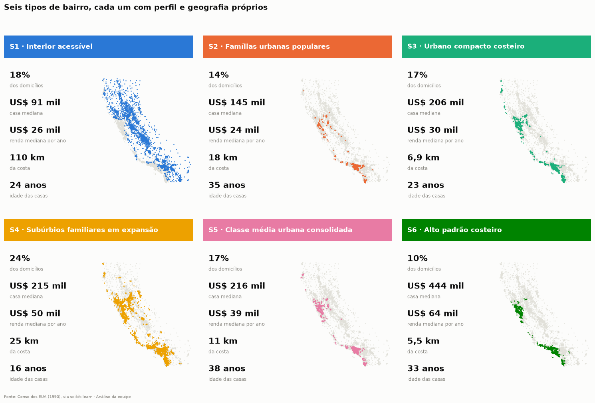
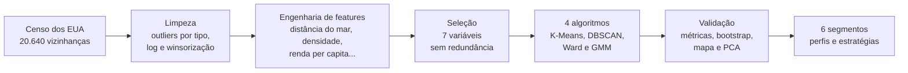
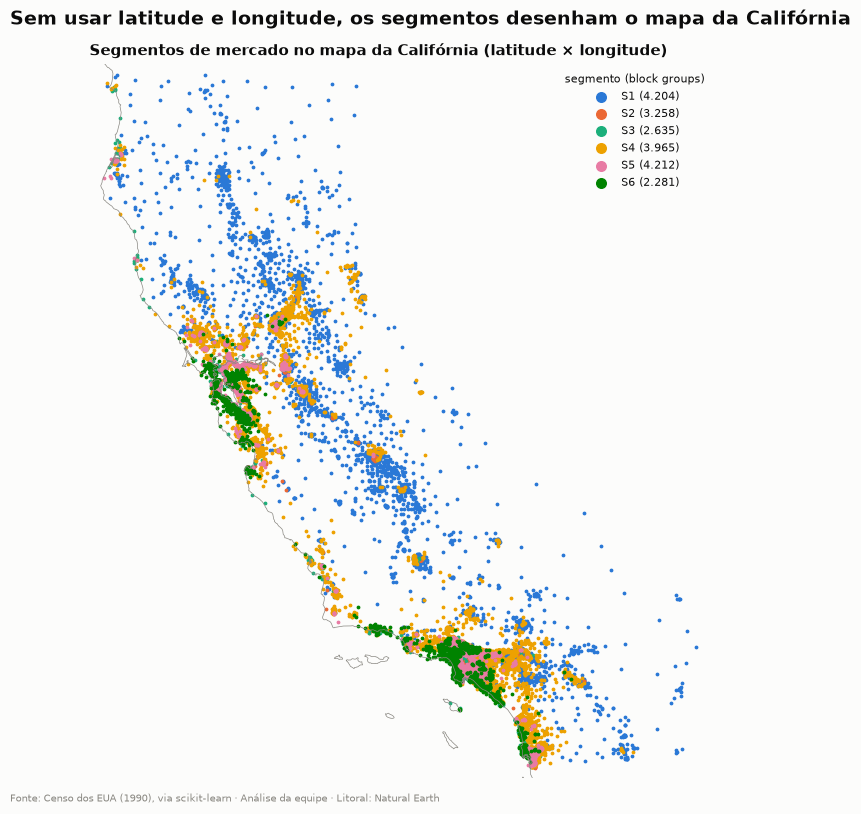
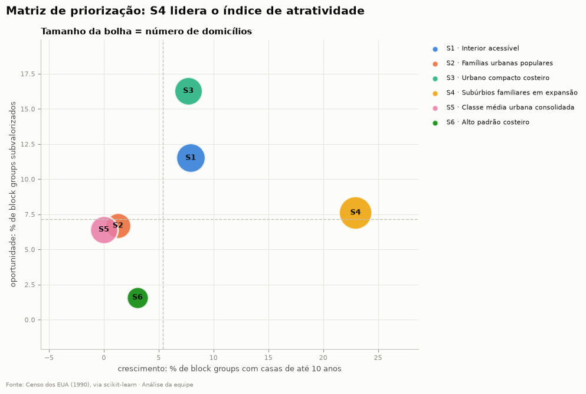

# Segmentação do Mercado Imobiliário da Califórnia

### Seis tipos de bairro, uma estratégia para cada um

[](https://colab.research.google.com/github/YanSamuray/mba-fgv-clusterizacao-imobiliaria/blob/main/projetofinal.ipynb)

Projeto final da disciplina **Aprendizado Não Supervisionado** (Prof. Sergio Polimante) do Executive MBA em Business Analytics e Big Data da **FGV**.

Aplicamos técnicas de clusterização a 20.640 vizinhanças do Censo dos EUA para substituir a segmentação tradicional, por cidade e faixa de preço, por **segmentos baseados no comportamento real dos bairros**. Cada segmento termina numa estratégia de negócio.



## O problema

Uma imobiliária da Califórnia segmenta o mercado por **cidade** e por **faixa de preço**. Essa divisão esconde diferenças importantes: dois bairros com o mesmo preço podem ter clientes completamente diferentes.

A pergunta: **existe uma divisão melhor, que oriente marketing, equipes de vendas, investimento e precificação?**

## A abordagem



- **Dados enriquecidos:** litoral (Natural Earth), condados (US Census Bureau) e cidades, para criar variáveis de localização sem usar latitude e longitude diretamente.
- **Escolha do número de segmentos:** cotovelo, silhouette, Davies-Bouldin e estabilidade por bootstrap. O k = 6 é o maior número de segmentos que continua estável.
- **Validação em quatro frentes:** métricas internas comparadas com rótulos aleatórios, separação e coesão, estabilidade (ARI de 0,94 em 30 reamostragens) e coerência no mapa.
- **Técnicas avançadas:** níveis de granularidade (macro-segmentos), clusterização recursiva (subsegmentos) e ensemble de K-Means, GMM e Ward.

## Resultados

| Segmento | Domicílios | Casa mediana | Quem é | Papel na estratégia |
|---|---|---|---|---|
| **S1 · Interior acessível** | 18% | US$ 91 mil | famílias de renda baixa a média no Vale Central | volume e financiamento |
| **S2 · Famílias urbanas populares** | 14% | US$ 145 mil | famílias grandes nos bairros mais densos de Los Angeles | locação e acesso à moradia |
| **S3 · Urbano compacto costeiro** | 17% | US$ 206 mil | solteiros e casais em apartamentos perto do mar | investidores e captação |
| **S4 · Subúrbios familiares em expansão** | 24% | US$ 215 mil | famílias de renda média-alta em casas novas | **prioridade nº 1:** lançamentos |
| **S5 · Classe média urbana consolidada** | 17% | US$ 216 mil | classe média nos bairros antigos das metrópoles | revenda e reforma |
| **S6 · Alto padrão costeiro** | 10% | US$ 444 mil ou mais | a maior renda do estado, a 5,5 km do mar | margem e relacionamento |

**Principais achados:**

1. **Preço não define o cliente:** S3, S4 e S5 custam o mesmo e são mercados opostos.
2. **O mar vale por si só:** a casa mediana custa US$ 256 mil até 5 km da costa e US$ 87 mil a mais de 80 km.
3. **O crescimento está nos subúrbios:** S4 tem 23% dos bairros com casas novas e o maior número de domicílios.
4. **O alto padrão é pequeno em clientes e grande em valor:** S6 tem 10% dos domicílios e 21% do valor do estoque.

<p>
  
  
</p>

## Equipe

- Jorge Adriano Fontes de Almeida Filho
- Rafael Collet
- Stephanie Santin Padovesi
- Thaís Pereira de Vasconcelos Moreira
- Yan Samuray Siepamann Vieira

## Stack

Python · pandas · scikit-learn · GeoPandas · Matplotlib · Seaborn · SciPy · uv

## Estrutura

| Caminho | Conteúdo |
|---|---|
| `projetofinal.ipynb` | notebook de entrega, executado e com as saídas salvas |
| `tools/notebook/` | gerador do notebook: código e textos de cada seção, execução e checklist |
| `assets/` | figuras usadas neste README |
| `archive/` | versão anterior (apenas a preparação dos dados) |
| `docs/` | enunciado do projeto |
| `data/` | arquivos externos baixados pelo notebook e a segmentação exportada (fora do controle de versão) |

## Como reproduzir

### No Google Colab

Abra o notebook pelo badge acima ou envie `projetofinal.ipynb` ao Google Drive e use **Runtime → Run all** (Ambiente de execução → Executar tudo). O Colab já traz todas as bibliotecas usadas. A execução completa leva cerca de 5 minutos e precisa de internet para baixar os dados.

### Localmente

Pré-requisito: [uv](https://docs.astral.sh/uv/). O Python 3.14 é selecionado pelo `.python-version`.

```powershell
uv sync --locked
uv run --locked python -m jupyterlab
```

No VS Code, abra `projetofinal.ipynb` e selecione o kernel `.venv\Scripts\python.exe` do projeto.

> **Windows:** mantenha o projeto numa pasta de caminho curto. Caminhos longos, como os de pastas sincronizadas pelo OneDrive, passam do limite de 260 caracteres e quebram a importação do Matplotlib. Veja a [documentação da Microsoft](https://learn.microsoft.com/windows/win32/fileio/maximum-file-path-limitation).

### Gerar o notebook a partir do código-fonte

O notebook é montado a partir de `tools/notebook/`:

- `cells_*.py`: código e textos de cada seção;
- `subs.py`: escolhas de modelagem;
- `interp_*.py`: interpretações.

Para gerar, executar, embutir a imagem do resumo executivo e conferir:

```powershell
uv run python tools/notebook/make_nb.py
uv run python tools/notebook/export_assets.py
```

O checklist (`check_nb.py`) confere:

- zero erros e zero avisos;
- todas as seções do enunciado;
- nenhum código comentado;
- todos os integrantes na primeira célula.

### Dados

- **California Housing:** `sklearn.datasets.fetch_california_housing`, com uma cópia pública como alternativa.
- **Externos,** baixados uma vez para `data/`:
  - limites dos condados (US Census Bureau, via Plotly);
  - litoral do Natural Earth (1:10 milhões);
  - maiores cidades dos EUA (Plotly);
  - versão do Kaggle do dataset, usada só para validar a distância até a costa.
- **Saída:** `data/segmentos_california.csv`, com o segmento de cada bairro.
